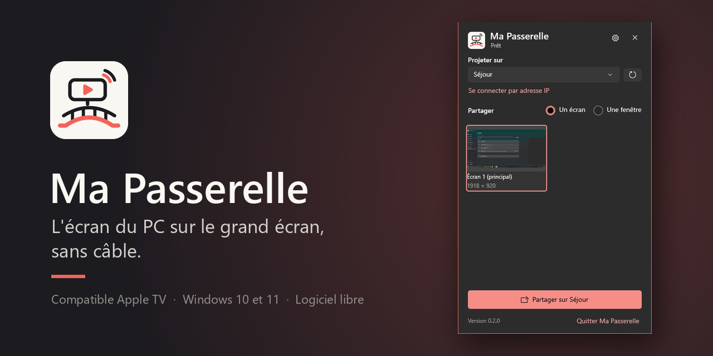
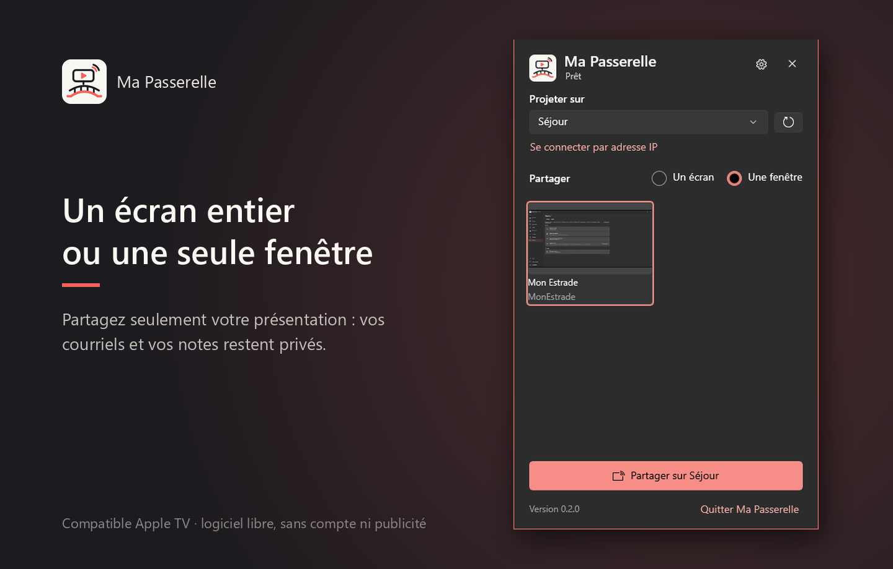
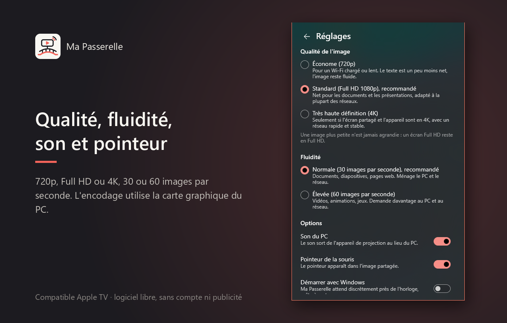
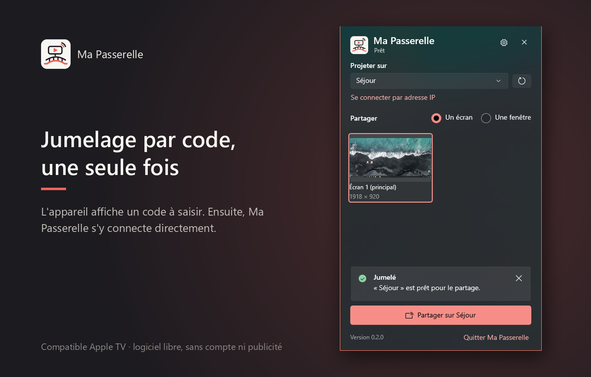

<p align="center">
  
</p>

<p align="center">
  <a href="https://apps.microsoft.com/detail/9PJB8758J79C?mode=direct">
    
  </a>
</p>

<p align="center">
  <a href="https://github.com/gaeremy/ma-passerelle/releases">Version sans installation</a>
  &nbsp;·&nbsp;
  <a href="store/confidentialite.md">Confidentialité</a>
  &nbsp;·&nbsp;
  <a href="https://github.com/gaeremy/ma-passerelle/issues">Signaler un problème</a>
</p>

<br>

Ma Passerelle affiche l'écran de votre PC sur un téléviseur ou un projecteur relié à une Apple TV.
Pas de câble à tirer jusqu'au tableau, pas d'adaptateur à chercher. Le son suit l'image.

Elle a été écrite pour la classe, en compagnon de [Mon Estrade](https://apps.microsoft.com/detail/9NM7R8V8Q0H9),
mais elle marche aussi très bien toute seule. C'est un logiciel libre, gratuit, sans compte ni publicité.

## Comment ça marche

1. Cliquez sur l'icône de Ma Passerelle, près de l'horloge.
2. Choisissez l'appareil, puis l'écran ou la fenêtre à montrer.
3. Cliquez sur « Partager ». C'est tout.

La première fois, l'appareil affiche un code à quatre chiffres. Vous le tapez une fois, et Ma Passerelle
s'en souvient.

<table>
  <tr>
    <td width="33%"></td>
    <td width="33%"></td>
    <td width="33%"></td>
  </tr>
  <tr>
    <td align="center"><sub>Une seule fenêtre, et vos courriels restent privés</sub></td>
    <td align="center"><sub>720p, Full HD ou 4K, son et pointeur</sub></td>
    <td align="center"><sub>Un code, une fois pour toutes</sub></td>
  </tr>
</table>

## Ce qu'il faut

Un PC sous Windows 10 (version 2004 ou plus récente) ou Windows 11, et une Apple TV ou un téléviseur
compatible sur le même réseau. La vidéo est encodée par la carte graphique du PC quand c'est possible,
ce qui ménage la batterie des portables.

## Questions

**L'appareil n'apparaît pas dans la liste.**
Vérifiez qu'il est allumé et sur le même réseau que le PC. Les réseaux d'école séparent parfois les
appareils. Dans ce cas, « Se connecter par adresse IP » permet de l'ajouter à la main. L'adresse se
trouve dans les réglages réseau de l'Apple TV.

**Le son sort encore du PC.**
Activez « Son du PC » dans les réglages (la roue dentée). Le changement compte au prochain partage.

**Et Miracast, Chromecast ?**
Pour Miracast, Windows sait déjà le faire avec la touche Windows + K. Chromecast n'est pas prévu pour
l'instant.

**La version sans installation affiche un avertissement.**
L'exécutable n'est pas signé, Windows SmartScreen le signale donc. Cliquez sur « Informations
complémentaires », puis « Exécuter quand même ». La version du Microsoft Store n'a pas ce souci, et
se met à jour toute seule.

<details>
<summary><b>Pour les développeurs</b></summary>

### Ligne de commande

`mapasserelle.exe` pilote Ma Passerelle depuis un autre programme. C'est ce qu'utilise Mon Estrade.
Dans la version du Store, la commande `mapasserelle` est un alias de l'application. Suivie d'une
commande, elle passe la main à la ligne de commande avec les mêmes entrées et sorties. Seule, elle
ouvre le panneau.

```
mapasserelle discover
mapasserelle pair --to "Salle 12"
mapasserelle mirror --to "Salle 12"
mapasserelle mirror --to 192.168.1.20 --window-title "Mon Estrade" --resolution 720
```

Pendant un partage, `stop` puis Entrée l'arrête et `status` donne l'état. `mapasserelle help` liste
toutes les options. Avec `--json`, chaque événement sort sur une ligne JSON en UTF-8. Le contrat
complet est dans [docs/CONTRAT.md](docs/CONTRAT.md).

### Compiler

Windows 10 ou 11 (x64 ou ARM64) et le SDK .NET 10.

```
build.cmd              :: version autonome dans dist\MaPasserelle
build.cmd -Run         :: la même, puis la lance
build.cmd -Msix        :: paquet MSIX pour le Microsoft Store, dans dist\msix
dotnet test vendor/WinPlay/tests/WinPlay.Core.Tests/WinPlay.Core.Tests.csproj -c Release
```

### Le dépôt

| Dossier | Contenu |
|---|---|
| `src/MaPasserelle.App` | L'application : icône, panneau, réglages, jumelage |
| `src/MaPasserelle` | La ligne de commande et ses événements JSON |
| `src/MaPasserelle.Engine` | Le moteur commun : recherche des appareils, jumelages, partage |
| `src/MaPasserelle.Capture` | Capture d'écran et de fenêtre, encodage vidéo |
| `vendor/WinPlay` | Le protocole, repris de [WinPlay](https://github.com/dineshdhotrad/WinPlay) (voir [UPSTREAM.md](vendor/WinPlay/UPSTREAM.md)) |
| `store` | Fiche du Microsoft Store, captures, confidentialité |

En cas de souci, le journal des erreurs est dans `%APPDATA%\MaPasserelle\erreurs.log`.

</details>

## Licence

Ma Passerelle est distribuée sous licence [GPL-3.0-or-later](LICENSE). Elle s'appuie sur
[WinPlay](https://github.com/dineshdhotrad/WinPlay) de Dinesh Dhotrad, sous la même licence, qui
reprend lui-même le travail de [doubletake](https://github.com/omarroth/doubletake) (LGPL). Merci à
eux. Les crédits complets sont dans [THIRD_PARTY_NOTICES.md](THIRD_PARTY_NOTICES.md).

<sub>Apple TV et AirPlay sont des marques d'Apple Inc. Ma Passerelle est un logiciel indépendant, ni
affilié à Apple, ni approuvé par Apple, et ne contient aucun code ni aucune clé d'Apple.</sub>
