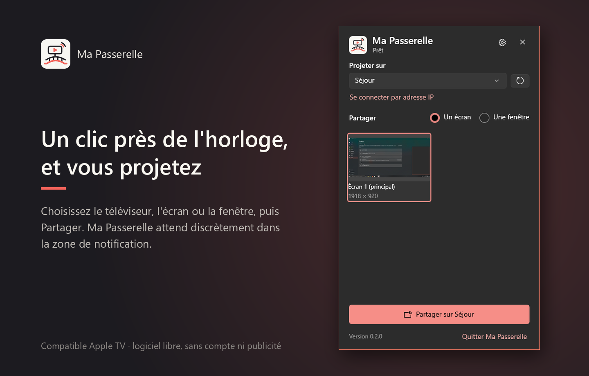

# Ma Passerelle


Partagez l'écran de votre PC Windows, ou une seule fenêtre, sur un téléviseur ou un projecteur
**compatible Apple TV**, image et son, sans câble.

Pensée pour la classe et les réunions : vous restez à votre bureau, la salle voit le grand écran.
Compagnon de [Mon Estrade](https://apps.microsoft.com/detail/9NM7R8V8Q0H9), la boîte à outils de
l'enseignant, et utilisable tout seul. Logiciel libre, sans compte, sans publicité, sans pistage.

<p align="center">
  
</p>

## Installer

- **Microsoft Store** (recommandé, mises à jour automatiques) :
  [Ma Passerelle](https://apps.microsoft.com/detail/9PJB8758J79C)
- **Version autonome** : télécharger le zip de la dernière version dans
  [Releases](https://github.com/gaeremy/ma-passerelle/releases), le décompresser, puis lancer
  `MaPasserelle.App.exe`. Rien à installer : .NET et Windows App SDK sont inclus.
  Windows peut afficher un avertissement SmartScreen, car l'exécutable n'est pas signé.

Il faut Windows 10 (version 2004 ou plus récente) ou Windows 11, et un appareil compatible Apple TV
sur le même réseau.

## Ce que fait Ma Passerelle

- **Un clic près de l'horloge** : choisir l'appareil, l'écran ou la fenêtre, puis « Partager ».
  Un clic droit sur l'icône permet de partager, d'arrêter ou de quitter.
- **Un écran entier ou une seule fenêtre** : vos courriels et vos notes restent privés.
  Le partage s'arrête de lui-même si la fenêtre partagée est fermée.
- **Image et son**, avec le pointeur de la souris. Qualité 720p, Full HD ou 4K,
  30 ou 60 images par seconde.
- **Encodage par la carte graphique** (Intel, NVIDIA ou AMD) quand elle le permet, sans réglage.
- **Jumelage par code**, une seule fois par appareil. Connexion par adresse IP si l'appareil
  n'apparaît pas dans la liste.
- **Démarrage avec Windows** en option, discrètement dans la zone de notification.

| | | |
|---|---|---|
|  |  |  |

## La ligne de commande

`mapasserelle.exe` permet de piloter Ma Passerelle depuis d'autres programmes (Mon Estrade) et sert
aux essais. Dans la version du Store, la commande `mapasserelle` est un alias de l'application :
suivie d'une commande, elle passe la main à la ligne de commande avec les mêmes entrées et sorties ;
seule, elle ouvre le panneau.

```
mapasserelle discover
mapasserelle pair --to "Salle 12"
mapasserelle mirror --to "Salle 12"
mapasserelle mirror --to 192.168.1.20 --window-title "Mon Estrade" --resolution 720
```

Pendant le partage, taper `stop` puis Entrée pour arrêter, ou `status` pour voir où on en est.
`mapasserelle help` liste toutes les options.

Pour piloter Ma Passerelle depuis un autre programme, ajouter `--json` : chaque événement sort alors
sur une ligne JSON (UTF-8). Le contrat complet est dans [docs/CONTRAT.md](docs/CONTRAT.md).

## Compiler

Il faut Windows 10 ou 11 (x64 ou ARM64) et le SDK .NET 10.

```
build.cmd              :: version autonome dans dist\MaPasserelle
build.cmd -Run         :: la même, puis la lance
build.cmd -Msix        :: paquet MSIX non signé pour le Microsoft Store (dist\msix)
dotnet test vendor/WinPlay/tests/WinPlay.Core.Tests/WinPlay.Core.Tests.csproj -c Release
```

## Organisation du dépôt

| Dossier | Contenu |
|---|---|
| `src/MaPasserelle.App` | L'application : icône près de l'horloge, panneau, réglages, jumelage. |
| `src/MaPasserelle` | La ligne de commande (`mapasserelle.exe`) et ses événements JSON. |
| `src/MaPasserelle.Engine` | Le moteur commun : recherche des appareils, jumelages, partage. |
| `src/MaPasserelle.Capture` | Capture d'écran et de fenêtre, encodage vidéo, dérivés de WinPlay. |
| `vendor/WinPlay` | Le protocole, repris de [WinPlay](https://github.com/dineshdhotrad/WinPlay). Voir [UPSTREAM.md](vendor/WinPlay/UPSTREAM.md). |
| `assets/icon` | L'icône (SVG, PNG, ICO). |
| `docs` | Le contrat de pilotage. |
| `store` | Fiche du Microsoft Store, captures, politique de confidentialité. |

## Vie privée

Ma Passerelle ne se connecte pas à Internet et n'envoie rien à l'éditeur. L'image et le son vont
seulement à l'appareil choisi, sur le réseau local, et seulement pendant le partage.
Détails : [politique de confidentialité](store/confidentialite.md).

## Signaler un problème

Ouvrir une [issue](https://github.com/gaeremy/ma-passerelle/issues) en précisant la version de
Windows, le modèle d'appareil et le message affiché. Le journal des erreurs se trouve dans
`%APPDATA%\MaPasserelle\erreurs.log`.

## Licence

Ma Passerelle est un logiciel libre distribué sous licence **GPL-3.0-or-later**
(voir [LICENSE](LICENSE)). Il s'appuie sur WinPlay de Dinesh Dhotrad, sous la même licence ;
les crédits détaillés sont dans [THIRD_PARTY_NOTICES.md](THIRD_PARTY_NOTICES.md).

Ma Passerelle est un programme indépendant. Mon Estrade le lance comme un processus séparé
et échange avec lui uniquement par la ligne de commande et les flux standard.

Apple TV et AirPlay sont des marques d'Apple Inc. Ce projet n'est ni affilié à Apple,
ni approuvé par Apple, et ne contient aucun code ni aucune clé d'Apple.
